**SCO is an AI company based in Ankara.** We build our own AI models and install them inside the companies that use them: on their own servers or private cloud, wired into their ERP, documents and internal tools. Questions, documents and answers stay on their side.

### How a deployment works

1. **Map.** We sit with your team and map the data, the systems and the decisions where AI should help.
2. **Install.** The model goes onto your hardware or private cloud. It has no route to the internet.
3. **Connect.** We connect it to your ERP and internal tools, scoped to the permissions each role already has.
4. **Run.** We review answer quality with your team and install model updates inside your network. You keep the keys.

### Where it runs

| On your servers | Private cloud | Air-gapped |
| :-- | :-- | :-- |
| Your data centre | Your cloud account | Isolated servers you own |
| No internet needed | No internet needed | No internet, by design |

Already using another model? We integrate, evaluate and run third-party and open-source models as well.

### Products

- **[SCO Messenger](https://messenger.sco.tr)**: team messaging with work cards, on iOS, Android, web and desktop.
- **SCO Kasa**: end-to-end encrypted vault for keys and passwords. Used in-house.

### The SCO group

[inavo](https://sco.tr/en/inavo) &nbsp;·&nbsp; [SAVARON](https://sco.tr/en/savaron) &nbsp;·&nbsp; [SCON](https://sco.tr/en/scon)

 

[sco.tr](https://sco.tr/en) &nbsp;·&nbsp; [How it works](https://sco.tr/en/how-it-works) &nbsp;·&nbsp; [Talk to us](https://sco.tr/en/contact)
